

  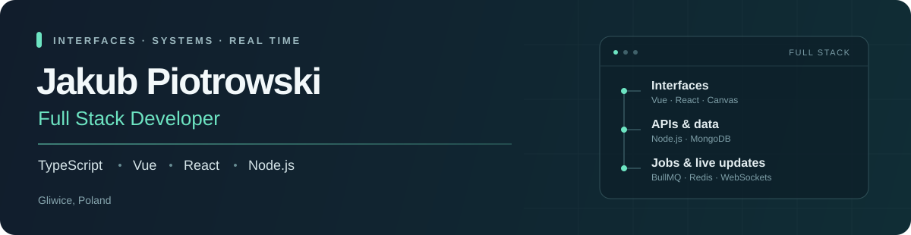

  <a href="https://www.linkedin.com/in/jakub-piotrowski-7296b12a7/">LinkedIn ↗</a>
  &nbsp;·&nbsp;
  <a href="mailto:jakub.piotrowski666@gmail.com">Email ↗</a>
  &nbsp;·&nbsp;
  <a href="https://lm-u-ml.vercel.app/">Live app ↗</a>

I develop features at **Hypris** — Vue and Canvas interfaces, Node.js APIs, **BullMQ/Redis** jobs, **WebSockets**, collaborative editing and **AI/MCP** integrations. Outside work, I build with **React and TypeScript**.

## Tech stack

**Frontend**

  
  
  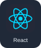
  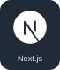
  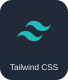
  
  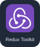
  

**Backend & data**

  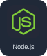
  
  
  
  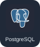
  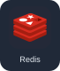
  
  
  

**Real time · AI · apps**

  
  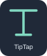
  
  
  
  
  
  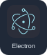
  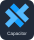

<b>More tools &amp; libraries</b>

**UI & data:** VueUse · Vue Router · React Router · Axios · Framer Motion 
**Visualization:** Canvas 2D · Chart.js · Mapbox 
**Build & tools:** Git · Vite · Docker · GitHub Actions 
**Testing & observability:** Vitest · Jest · Playwright · Sentry · Prometheus

## Selected work

### [LM-U-Ml ↗](https://lm-u-ml.vercel.app/)

**Live app · Active users** — Football predictions, live rankings and server-side scoring with React, Redux Toolkit and Firebase.

### [Supervisor Selection System ↗](https://github.com/Piterovskyyy/supervisor-selection-system)

**React / FastAPI / PostgreSQL** — Supervisor selection with role-based workflows, preference drafts, allocation rounds, PDF/XLSX reports and notifications.

### [Free Events ↗](https://github.com/Piterovskyyy/free-events)

**React / Spring Boot / MongoDB** — Event discovery, registrations, PDF/QR tickets, Firebase uploads and multipart APIs.

[Also: Frontend Notifications ↗](https://github.com/Piterovskyyy/frontend-notifications) · React/Redux architecture, optimistic updates and cursor pagination with a mock API.

---

Gliwice, Poland · Computer Science at Silesian University of Technology · Football & tennis
